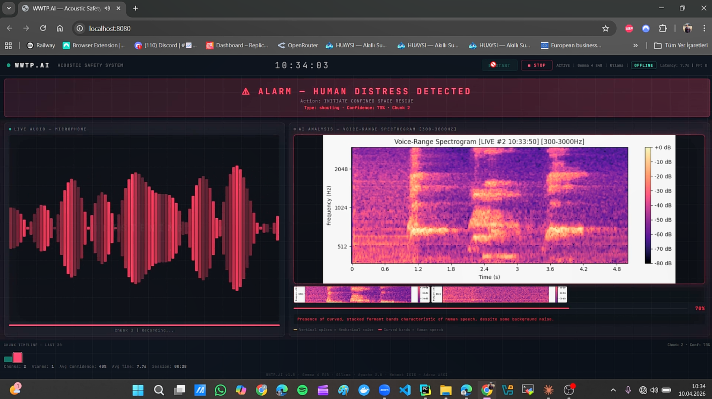

# WWTP Acoustic Safety System — Can AI Hear What Human Ears Miss?

**Research prototype of an acoustic safety system for wastewater treatment plants. Gemma 4 E4B, running 100% offline via Ollama.**

---


-orange?style=for-the-badge)

**🎬 [Live Web Demo](https://wwtp-acoustic-safety-system.vercel.app) · 📺 [Field Test Video](https://www.youtube.com/watch?v=_9wYBELt0rU) · 📄 [Hackathon Writeup](https://www.kaggle.com/competitions/gemma-4-good-hackathon/writeups/can-ai-hear-what-human-ears-miss-acoustic-safety) · 📊 [Dataset on Kaggle](https://www.kaggle.com/datasets/mehmetisik/wwtp-acoustic-safety-benchmark)**

> **Status (22 November 2026): research prototype — not a validated safety system.**
>
> **April 2026 result:** the hackathon result (91.0/100, "CERTAIN SURVIVAL") came from a single run. In that run, the few-shot reference spectrograms for S1–S4 were taken from the same scenes that were scored.
>
> **Re-measurement:** same machine, same model weights, April-era Ollama:
> - **45.0/100 with leak-free references** (one run);
> - **47.0 and 51.0 with the April references** (two runs).
>
> The critical S5 scenario was not detected in any of these runs. Details: [Re-measurement](#re-measurement-november-2026).
>
> The live demo and the Kaggle writeup still show the April numbers.

---

## The Story

A worker fell into a clarifier pool at a drinking water treatment plant in Adana, Turkey. He screamed for help. Nobody heard him — 95dB construction noise masked everything.

We asked: **what if an AI had been listening?**

This project is an attempt to answer that question.

---

## How It Works

```
WAV Audio (5s chunks)
    → Mel Spectrogram (300-3000Hz, power_to_db, magma colormap)
        → 4 Few-Shot Reference Examples
            → Chain-of-Thought 3-Step Reasoning
                → Debouncing (CONFIRM_MIN_ALARMS=1)
                    → SCADA Action (ESTOP / RESCUE / MONITOR)
```

The system converts audio into spectrogram images and uses Gemma 4 E4B's vision capability to detect human voice patterns (formants) hidden in industrial noise. A 3-step Chain-of-Thought protocol ensures the model reasons through what it sees before making a decision.

---

## Re-measurement (November 2026)

**Setup:**
- Same machine (RTX 3060 Laptop, 6 GB VRAM).
- Same model weights (`gemma4:e4b`, digest `c6eb396dbd59`).
- Same engine code, plus the reference-selection fix.
- Temperature 0.

Scores are PROTOCOL mode, weighted average (S1 ×0.1, S2 ×0.2, S3 ×0.1, S4 ×0.2, S5 ×0.4). Logs and full setup: [`results/gemma4-e4b/remeasure-2026-11-22/`](results/gemma4-e4b/remeasure-2026-11-22/).

| Run | S1 | S2 | S3 | S4 | S5 | Weighted |
|-----|----|----|----|----|----|----------|
| April 2026 — single run, references from the scored scenes | 60 | 95 | 60 | 100 | 100 | 91.0 |
| Ollama 0.20.2 — April references, run 1 | 60 | 75 | 60 | 100 | 0 | 47.0 |
| Ollama 0.20.2 — April references, run 2 | 60 | 95 | 60 | 100 | 0 | 51.0 |
| **Ollama 0.20.2 — leak-free references** | **60** | **75** | **60** | **90** | **0** | **45.0** |
| Ollama 0.40.17 — either reference set | 60 | 0 | 60 | 0 | 0 | 12.0 |

**What this means:**

- **91.0 did not reproduce.** Almost the whole gap is S5 (weight 0.4). Its single April alarm window (25–30 s, confidence 0.75) did not alarm in any run on Ollama 0.20.2 (confidence 0.3).
- **The reference leak was real but small here: 47.0 → 45.0.** In S4, the two windows that lost their alarm are the April human reference itself and the window right after it.
- **Temperature 0 did not make runs identical.**
  - Two identical runs differed in 5 of 60 windows, including one alarm in S2.
  - A single run is not a score. Report the mean and range of several runs.
- **The Ollama version changes the result.**
  - On Ollama 0.40.17 (on our test machine), gemma4:e4b describes the spectrogram as a "line chart". It answers "no human" even for an image byte-identical to its own human reference.
  - A control model (qwen3.5:4b) reads the same image correctly.
  - Every window becomes "no detection".
- **No false alarms** in the no-human scenes (S1, S3) in any run.

### Known issues

- **An analysis failure is scored as "no human".**
  - When the model was unavailable (HTTP 404), the engine recorded "no detection, confidence 0.0" and finished normally ([invalid run log](results/gemma4-e4b/remeasure-2026-11-22/INVALID_ollama-0.20.2_leak-free_model-deleted-http404.txt)).
  - A safety system must report this as a fault (fail-closed).
- **Detection delays are counted from the window start.**
  - "+5 s" means the voice was found in the 25–30 s window. The alarm itself is raised only after the window closes and the model answers.
  - In the April run, the S5 alarm came about 17 s after the scream started: onset at 20 s, window end at 30 s, then 7.3 s of analysis.
- **The live detector does not listen while it analyses.** It records 5 s, then analyses for about 7 s, so it hears at most ~42% of the time.
- **The final summary divides by three modes even when only PROTOCOL runs.** "GRAND WEIGHTED AVERAGE" shows 15.0 for a 45.0 run; read the PROTOCOL row.
- **Pin the Ollama version.** The Windows app updates itself, and Ollama 0.40.17 broke the image path on our test machine without any error.

### April 2026 hackathon run (historical — did not reproduce)

| Scene | Description | Human | Noise | Score | FP | Detection window |
|-------|-------------|-------|-------|-------|----|------------------|
| S1 | Pump Room — Normal Operation | NO | 75 dB | 60/100 | 0 | — |
| S2 | Construction Zone — Human Distress | YES | 95 dB | 95/100 | 0 | 25s (+0s) |
| S3 | Pool Edge — Metallic False Alarm Test | NO | 72 dB | 60/100 | 0 | — |
| S4 | Manhole Gallery — Masked Worker | YES | 58 dB | 100/100 | 0 | 25s (+5s) |
| **S5** | **Clarifier Pool — REAL INCIDENT** | **YES** | **95 dB** | **100/100** | **0** | **25s (+5s)** |

- Weighted average 91.0/100, 0 false positives, single run.
- The few-shot references for S1–S4 came from these same scenes.
- The April notes report 5/5 identical runs at temperature 0. In November, two identical runs differed in 5 of 60 windows.

---

## Model Comparison: E4B vs E2B

Both Gemma 4 audio-capable models were tested with identical pipeline configuration — same spectrograms, same few-shot examples, same CoT prompt, same temperature=0.

> April 2026, single runs with the leaky reference set. E2B was not re-measured; E4B's 91.0 did not reproduce (see [Re-measurement](#re-measurement-november-2026)).

| Metric | E2B (2B params) | E4B (4B params) |
|--------|-----------------|-----------------|
| Weighted Average | 2.0/100 | 91.0/100 (not reproduced) |
| False Positives | 37/60 chunks | 0/60 chunks |
| CoT Reasoning | Not functional | Fully functional |
| Speed per chunk | ~6.2s | ~7.0s |
| Verdict (April run) | **Unusable** | S5 detected — not reproduced |

> *"E2B alarmed on everything — pump rooms, metallic sounds, silence. E4B distinguished human voice from noise with zero false positives. The extra 2B parameters enable Chain-of-Thought reasoning, which is the critical capability for safety systems."*

---

## Field Validation at Ceyhan WWTP

[](https://www.youtube.com/watch?v=_9wYBELt0rU)

▶️ **[Watch the full field test on YouTube](https://www.youtube.com/watch?v=_9wYBELt0rU)**

The system was tested at the actual facility with a laptop's built-in microphone — fully offline (WiFi disabled, ethernet unplugged).

| Location | Noise Level | Chunks | Alarms | FP | Max Confidence | Result |
|----------|-------------|--------|--------|-----|----------------|--------|
| Underground pump gallery | ~75dB (echo + pumps) | 8 | 2 | 0 | 70% | **DETECTED** |
| Blower room | >100dB (extreme) | 13 | 0 | 0 | 20% | Microphone limit |
| **Clarifier pool (incident site)** | **~65dB** | **9** | **4** | **0** | **95%** | **DETECTED** |
| **Total** | | **30** | **6** | **0** | **95%** | **2/3 locations** |

**Zero false positives across 30 real-world chunks.** CoT reasoning transfers from synthetic training data to real industrial environments.

The blower room (>100dB) exceeded the laptop microphone's physical capacity — the ADC saturates, making all sound indistinguishable. Industrial-grade directional microphones are recommended for >100dB zones.

<p align="center">
  
  
</p>
<p align="center"><em>Left: Underground pump gallery — ALARM at 70% confidence. Right: Clarifier pool (incident site) — ALARM at 90% confidence.</em></p>

---

## The Journey — 3.0 → 91.0

8 iterations, 2 failed experiments, single runs from March–April 2026.
- In the final configuration, the few-shot references came from the scored scenes.
- The final 91.0 did not reproduce in November 2026: 47.0 and 51.0 on the same setup, 45.0 with leak-free references.

| # | Method | Score | Outcome |
|---|--------|-------|---------|
| 1 | Raw Audio + Aggressive Prompt | 3.0 | Model hallucinated — 7 false positives |
| 2 | Raw Audio + Neutral Prompt | 12.0 | FP cleaned but detection lost |
| 3 | Spectrogram 2-shot | 8.0 | Binary classifier trap |
| 4 | Spectrogram 4-shot + Filter | 27.0 | S2 breakthrough (95/100) |
| 5 | Spectrogram + CoT | 32.0 | S4 perfect (100/100), S3 FP solved |
| 6 | CoT + Debounce=1 | 91.0 | S5 detected but non-deterministic |
| 7 | PCEN + Spectral Subtraction | 32.0 | Failed — noise and signal same band |
| **8** | **CoT + Debounce=1 + Temp=0** | **91.0** | 5/5 identical runs reported in April; not reproduced in Nov 2026 |

---

## Resources

- 🎬 **Web Demo:** [https://wwtp-acoustic-safety-system.vercel.app](https://wwtp-acoustic-safety-system.vercel.app) — Interactive demo with chunk-by-chunk analysis, spectrograms, audio playback, and survival verdict animation.
- 📺 **Field Test Video:** [Watch on YouTube](https://www.youtube.com/watch?v=_9wYBELt0rU) — Real-world test at Ceyhan WWTP, fully offline.
- 📄 **Hackathon Writeup:** [Can AI Hear What Human Ears Miss? — Kaggle](https://www.kaggle.com/competitions/gemma-4-good-hackathon/writeups/can-ai-hear-what-human-ears-miss-acoustic-safety) — Full submission for Gemma 4 Good Hackathon 2026.
- 📊 **Dataset:** [WWTP Acoustic Safety Benchmark on Kaggle](https://www.kaggle.com/datasets/mehmetisik/wwtp-acoustic-safety-benchmark) — 5 synthetic scenes with scoring rubric and facility layout.

**Live Detector (real-time microphone):**
```bash
python live_detector.py                    # Terminal UI
python live_detector_ui.py                 # SCADA-style web UI (localhost:8080)
```
Real-time microphone monitoring with spectrogram analysis. Field-validated at Ceyhan WWTP.

---

## Quick Start

### Prerequisites

- Python 3.10+
- [Ollama](https://ollama.com) **0.20.2**: pin this version and turn off auto-update. On our test machine, Ollama 0.40.17 broke gemma4:e4b's image input (see [Known issues](#known-issues)).
- ffmpeg
- Git

### Installation

```bash
# Clone the repository
git clone https://github.com/mmehmetisik/wwtp-acoustic-safety-system.git
cd wwtp-acoustic-safety-system

# Install Python dependencies
pip install -r requirements.txt

# Pull the model
ollama pull gemma4:e4b

# Generate synthetic audio scenes
python audio_generator_tts.py

# Run the full evaluation
python acoustic_engine.py PROTOCOL --spectrogram
```

### Expected Output

Read the `PROTOCOL` row of the final table. With leak-free references (November 2026, one run, Ollama 0.20.2):

```
  MODE AVERAGES:
  Mode             S1     S2     S3     S4     S5   WGT AVG
  PROTOCOL         60     75     60     90      0      45.0

  S5 SURVIVAL VERDICTS — The Answer:
  PROTOCOL        NO DETECT   WOULD NOT HAVE SURVIVED
```

- Results vary from run to run.
- `--sizintili-referans` ("leaky references") reproduces the April reference set.
- Ignore the "GRAND WEIGHTED AVERAGE" line (known bug, see [Known issues](#known-issues)).

---

## Project Structure

```
wwtp-acoustic-safety-system/
├── acoustic_engine.py          # Main detection engine
├── live_detector.py            # Real-time microphone detector (terminal)
├── live_detector_ui.py         # SCADA-style web UI for live detection
├── audio_generator_tts.py      # Synthetic audio generator (TTS)
├── audio_generator.py          # Formant-based audio generator
├── dataset/
│   ├── audio/                  # Scene WAV files (60s each)
│   ├── scene_config.json       # Scene definitions
│   ├── scoring_rubric.json     # Asymmetric scoring system
│   └── wwtp_site_map.json      # Facility layout
├── findings/                   # 16 experiment documents + roadmap + blueprint
│   ├── 01_test_results.md
│   ├── ...
│   ├── 15_e2b_vs_e4b_comparison.md
│   └── 16_field_test_ceyhan_wwtp.md
├── results/                    # Model outputs + field test logs
│   ├── field-test/             # Real-world test terminal logs
│   ├── gemma4-e4b/             # E4B run outputs (+ remeasure-2026-11-22/)
│   └── gemma4-e2b/             # E2B run outputs
├── screenshots/                # Field test & UI screenshots
├── experiments/                # Early-stage test scripts
├── scripts/                    # Utility scripts
├── spectrogram_test/           # Spectrogram PNG visualizations
├── tests/                      # BARE / CONTEXT / PROTOCOL test suites
├── wwtp-acoustic-demo/         # React web demo (Vite + Tailwind)
└── wwtp-aerial.png             # Ceyhan WWTP aerial photograph
```

---

## Key Technical Insights

1. **Input representation > model size.** Performance gains were achieved not by scaling the model, but by aligning input representation with model strengths. Switching from raw audio to spectrograms unlocked the model's vision capability — 6x faster, dramatically more accurate.

2. **The problem is in the signal, not the model.** Industrial noise and human voice occupy the same 300-3000Hz frequency band. Signal processing (PCEN, spectral subtraction) cannot separate them — but spectrograms reveal different *visual* patterns. Flat bands = noise. Curved formants = human voice.

3. **Temperature 0 is necessary but not sufficient.** When someone's life depends on it, "sometimes" is not good enough. Yet in November 2026, two identical temperature-0 runs still differed in 5 of 60 windows, including one alarm. Stability has to be measured over repeated runs, not assumed from one.

---

## Built With

- **[Gemma 4 E4B](https://ai.google.dev/gemma)** — 4B parameter multimodal LLM
- **[Ollama](https://ollama.com)** — Local inference runtime
- **Python** — Pipeline engine
- **librosa** — Audio processing & spectrogram generation
- **matplotlib** — Spectrogram visualization
- **React + Vite** — Web demo framework
- **Tailwind CSS** — Styling

---

## Author

**Mehmet ISIK**
Data Scientist, Adana ASKI (Water and Sewerage Administration) | Kaggle Grandmaster

- [mehmetisik.dev](https://mehmetisik.dev)
- [LinkedIn](https://www.linkedin.com/in/mehmetisik4601/)
- [Kaggle](https://www.kaggle.com/mehmetisik)
- [GitHub](https://github.com/mmehmetisik)
- [Medium](https://medium.com/@mmehmetisik)

**Gemma 4 Good Hackathon 2026**

---

## License

This project is licensed under the [Apache License 2.0](LICENSE).

---

> *"What happens when you teach AI what to listen for? Maybe we can save a life."*
