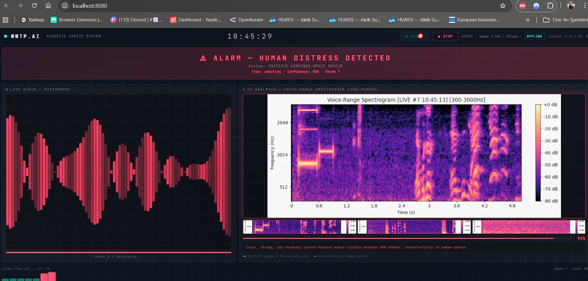

# WWTP Acoustic Safety System — Can AI Hear What Human Ears Miss?

**Industrial acoustic safety system for wastewater treatment plants. Powered by Gemma 4 E4B, running 100% offline via Ollama.**

---


-orange?style=for-the-badge)

---

## The Story

A worker fell into a clarifier pool at a drinking water treatment plant in Adana, Turkey. He screamed for help. Nobody heard him — 95dB construction noise masked everything.

We asked: **what if an AI had been listening?**

This system is the answer.

---

## How It Works

```
WAV Audio (5s chunks)
    → Mel Spectrogram (300-3000Hz, power_to_db, magma colormap)
        → 4 Few-Shot Reference Examples
            → Chain-of-Thought 3-Step Reasoning
                → Debouncing (CONFIRM_MIN_ALARMS=1)
                    → SCADA Action (ESTOP / RESCUE / MONITOR)
```

The system converts audio into spectrogram images and uses Gemma 4 E4B's vision capability to detect human voice patterns (formants) hidden in industrial noise. A 3-step Chain-of-Thought protocol ensures the model reasons through what it sees before making a decision.

---

## Key Results

| Scene | Description | Human | Noise | Score | FP | Detection |
|-------|-------------|-------|-------|-------|----|-----------|
| S1 | Pump Room — Normal Operation | NO | 75 dB | 60/100 | 0 | — |
| S2 | Construction Zone — Human Distress | YES | 95 dB | 95/100 | 0 | 25s (+0s) |
| S3 | Pool Edge — Metallic False Alarm Test | NO | 72 dB | 60/100 | 0 | — |
| S4 | Manhole Gallery — Masked Worker | YES | 58 dB | 100/100 | 0 | 25s (+5s) |
| **S5** | **Clarifier Pool — REAL INCIDENT** | **YES** | **95 dB** | **100/100** | **0** | **25s (+5s) → CERTAIN SURVIVAL** |

**Weighted Average: 91.0/100 | Total False Positives: 0 | Consistency: 5/5 identical runs (temperature=0)**

---

## Model Comparison: E4B vs E2B

Both Gemma 4 audio-capable models were tested with identical pipeline configuration — same spectrograms, same few-shot examples, same CoT prompt, same temperature=0.

| Metric | E2B (2B params) | E4B (4B params) |
|--------|-----------------|-----------------|
| Weighted Average | 2.0/100 | 91.0/100 |
| False Positives | 37/60 chunks | 0/60 chunks |
| CoT Reasoning | Not functional | Fully functional |
| Speed per chunk | ~6.2s | ~7.0s |
| Verdict | **Unusable** | **CERTAIN SURVIVAL** |

> *"E2B alarmed on everything — pump rooms, metallic sounds, silence. E4B distinguished human voice from noise with zero false positives. The extra 2B parameters enable Chain-of-Thought reasoning, which is the critical capability for safety systems."*

---

## Field Validation at Ceyhan WWTP

The system was tested at the actual facility with a laptop's built-in microphone — fully offline (WiFi disabled, ethernet unplugged).

| Location | Noise Level | Chunks | Alarms | FP | Max Confidence | Result |
|----------|-------------|--------|--------|-----|----------------|--------|
| Underground pump gallery | ~75dB (echo + pumps) | 8 | 2 | 0 | 70% | **DETECTED** |
| Blower room | >100dB (extreme) | 13 | 0 | 0 | 20% | Microphone limit |
| **Clarifier pool (incident site)** | **~65dB** | **9** | **4** | **0** | **95%** | **DETECTED** |
| **Total** | | **30** | **6** | **0** | **95%** | **2/3 locations** |

**Zero false positives across 30 real-world chunks.** CoT reasoning transfers from synthetic training data to real industrial environments.

The blower room (>100dB) exceeded the laptop microphone's physical capacity — the ADC saturates, making all sound indistinguishable. Industrial-grade directional microphones are recommended for >100dB zones.

<p align="center">
  
  
</p>
<p align="center"><em>Left: Underground pump gallery — ALARM at 70% confidence. Right: Clarifier pool (incident site) — ALARM at 90% confidence.</em></p>

---

## The Journey — 3.0 → 91.0

8 iterations. 2 failed experiments. 30x improvement.

| # | Method | Score | Outcome |
|---|--------|-------|---------|
| 1 | Raw Audio + Aggressive Prompt | 3.0 | Model hallucinated — 7 false positives |
| 2 | Raw Audio + Neutral Prompt | 12.0 | FP cleaned but detection lost |
| 3 | Spectrogram 2-shot | 8.0 | Binary classifier trap |
| 4 | Spectrogram 4-shot + Filter | 27.0 | S2 breakthrough (95/100) |
| 5 | Spectrogram + CoT | 32.0 | S4 perfect (100/100), S3 FP solved |
| 6 | CoT + Debounce=1 | 91.0 | S5 detected but non-deterministic |
| 7 | PCEN + Spectral Subtraction | 32.0 | Failed — noise and signal same band |
| **8** | **CoT + Debounce=1 + Temp=0** | **91.0** | **5/5 identical runs — STABLE** |

---

## Live Demo

**Web Demo:** [https://wwtp-acoustic-safety-system.vercel.app](https://wwtp-acoustic-safety-system.vercel.app)
Interactive demo with chunk-by-chunk analysis, spectrograms, audio playback, and survival verdict animation.

**Live Detector (real-time microphone):**
```bash
python live_detector.py                    # Terminal UI
python live_detector_ui.py                 # SCADA-style web UI (localhost:8080)
```
Real-time microphone monitoring with spectrogram analysis. Field-validated at Ceyhan WWTP.

---

## Quick Start

### Prerequisites

- Python 3.10+
- [Ollama](https://ollama.com) (v0.20.0+)
- ffmpeg
- Git

### Installation

```bash
# Clone the repository
git clone https://github.com/mmehmetisik/wwtp-acoustic-safety-system.git
cd wwtp-acoustic-safety-system

# Install Python dependencies
pip install -r requirements.txt

# Pull the model
ollama pull gemma4:e4b

# Generate synthetic audio scenes
python audio_generator_tts.py

# Run the full evaluation
python acoustic_engine.py PROTOCOL --spectrogram
```

### Expected Output

```
Weighted Average: 91.0/100
S5 Verdict: CERTAIN SURVIVAL (5s detection delay)
False Positives: 0
Consistency: 5/5 identical runs at temperature=0
```

---

## Project Structure

```
wwtp-acoustic-safety-system/
├── acoustic_engine.py          # Main detection engine
├── live_detector.py            # Real-time microphone detector (terminal)
├── live_detector_ui.py         # SCADA-style web UI for live detection
├── audio_generator_tts.py      # Synthetic audio generator (TTS)
├── audio_generator.py          # Formant-based audio generator
├── dataset/
│   ├── audio/                  # Scene WAV files (60s each)
│   ├── scene_config.json       # Scene definitions
│   ├── scoring_rubric.json     # Asymmetric scoring system
│   └── wwtp_site_map.json      # Facility layout
├── findings/                   # 15 experiment documents + roadmap
│   ├── 01_test_results.md
│   ├── ...
│   ├── 14_temperature_zero.md
│   └── 15_e2b_vs_e4b_comparison.md
├── results/                    # Model outputs + field test logs
│   ├── field-test/             # Real-world test terminal logs
│   ├── gemma4-e4b/             # E4B run outputs
│   └── gemma4-e2b/             # E2B run outputs
├── screenshots/                # Field test & UI screenshots
├── experiments/                # Early-stage test scripts
├── scripts/                    # Utility scripts
├── spectrogram_test/           # Spectrogram PNG visualizations
├── tests/                      # BARE / CONTEXT / PROTOCOL test suites
├── wwtp-acoustic-demo/         # React web demo (Vite + Tailwind)
└── wwtp-aerial.png             # Ceyhan WWTP aerial photograph
```

---

## Key Technical Insights

1. **Input representation > model size.** Performance gains were achieved not by scaling the model, but by aligning input representation with model strengths. Switching from raw audio to spectrograms unlocked the model's vision capability — 6x faster, dramatically more accurate.

2. **The problem is in the signal, not the model.** Industrial noise and human voice occupy the same 300-3000Hz frequency band. Signal processing (PCEN, spectral subtraction) cannot separate them — but spectrograms reveal different *visual* patterns. Flat bands = noise. Curved formants = human voice.

3. **Temperature=0 is mandatory for safety systems.** When someone's life depends on it, "sometimes" is not good enough. Deterministic inference eliminated S5 non-determinism and achieved 5/5 identical runs.

---

## Built With

- **[Gemma 4 E4B](https://ai.google.dev/gemma)** — 4B parameter multimodal LLM
- **[Ollama](https://ollama.com)** — Local inference runtime
- **Python** — Pipeline engine
- **librosa** — Audio processing & spectrogram generation
- **matplotlib** — Spectrogram visualization
- **React + Vite** — Web demo framework
- **Tailwind CSS** — Styling

---

## Author

**Mehmet ISIK**
Data Scientist, Adana ASKI (Water and Sewerage Administration) | Kaggle Grandmaster

- [mehmetisik.dev](https://mehmetisik.dev)
- [LinkedIn](https://www.linkedin.com/in/mehmetisik4601/)
- [Kaggle](https://www.kaggle.com/mehmetisik)
- [GitHub](https://github.com/mmehmetisik)
- [Medium](https://medium.com/@mmehmetisik)

**Gemma 4 Good Hackathon 2026**

---

## License

This project is licensed under the [Apache License 2.0](LICENSE).

---

> *"What happens when you teach AI what to listen for? Maybe we can save a life."*
